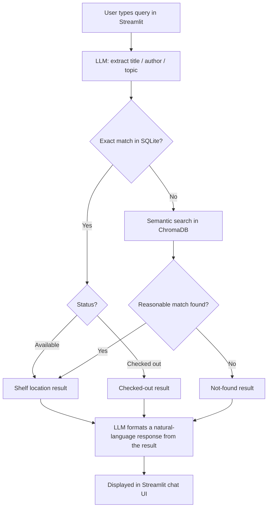

# Library Book Finder Assistant

**CAP 942 Capstone Project**

## Overview

An AI assistant that helps students find books in the library using natural language. Instead of knowing an exact title or call number, a student can ask a question like "do you have anything on World War II?" and get pointed to the right shelf.

**Problem it solves:** Students often know a topic or rough title but not the shelf location, and library staff spend time answering repetitive location questions.

**Intended users:** Students and work-study library staff.

## MVP Scope

The MVP is text-only (no voice) and includes exact, author, and topical search across a 234-book catalog.

**In scope (MVP), all implemented:**
- Text input from the user
- LLM-based intent extraction, with strict Pydantic validation limiting search types to `title`, `author`, or `topic`
- Case-insensitive partial title/author lookup against a library catalog (SQLite), including multiple matches
- Fuzzy/topical fallback search (semantic search via ChromaDB) when there's no exact match
- LLM-generated natural-language responses grounded in the search result
- Generic handling for "not found" and "checked out" cases; if multiple matches exist, returns one and reports the count
- Graceful error handling if the local LLM service is unreachable
- Structured timing logs for LLM, database, semantic-search, and end-to-end query performance

**Out of scope for now (future iterations):**
- Voice input (speech-to-text)
- Text-to-speech output
- Live integration with the school's real library system (ILS)

## Tech Stack

| Component | Tool | Purpose |
|---|---|---|
| LLM | Ollama (Llama 3.2 3B) | Extracts search intent from user text |
| Structured catalog | SQLite | Stores title, author, subject, shelf, copies, and availability |
| Semantic search | ChromaDB | Embeds book subjects for topical queries with no exact match |
| Data loading | pandas | Reads the 234-book seed CSV into the catalog |
| Validation | Pydantic | Validates LLM intent JSON and rejects unsupported search types or extra fields |
| Catalog source | Open Library Subjects API | Supplies subject-tagged books for the expanded catalog |
| App framework | Streamlit | Cached chat-style UI with conversation history |
| Logging | Python `logging` | Reports query-path and component timings |
| Dependency management | uv | Project setup and dependency management |

## Setup

The following end-to-end instructions use Windows PowerShell. Install Git, uv, and Ollama if they are not already installed. These commands use Windows Package Manager (`winget`):

```powershell
winget install --id Git.Git -e
winget install --id astral-sh.uv -e
winget install --id Ollama.Ollama -e
```

Close and reopen PowerShell after installation, then clone the repository and install the project's Python version and dependencies:

```powershell
git clone https://github.com/Code-ruto/AI-Solution-Developer-Capsone-Project.git
Set-Location AI-Solution-Developer-Capsone-Project
uv python install 3.14
uv sync
```

`uv sync` creates the project's `.venv` environment and installs the dependencies declared in `pyproject.toml`. The repository includes `BooksCatalog.csv`, which is used to seed the local databases.

Pull the local model used by the app:

```powershell
ollama pull llama3.2
```

Ollama normally runs as a background application after installation. If Ollama commands report that they cannot connect to the service, start the Ollama application from the Windows Start menu. Alternatively, run `ollama serve` in a separate PowerShell window and leave it running.

### Linux (Ubuntu/Debian)

Open a terminal and install Git and `curl`:

```bash
sudo apt update
sudo apt install -y git curl
```

Install uv and Ollama using their official installers:

```bash
curl -LsSf https://astral.sh/uv/install.sh | sh
curl -fsSL https://ollama.com/install.sh | sh
```

Restart the terminal so the `uv` command is available. Then clone the repository and install the project's Python version and dependencies:

```bash
git clone https://github.com/Code-ruto/AI-Solution-Developer-Capsone-Project.git
cd AI-Solution-Developer-Capsone-Project
uv python install 3.14
uv sync
```

Pull the LLM model and make sure the Ollama service is running:

```bash
ollama pull llama3.2
sudo systemctl enable --now ollama
```

On a Linux system without `systemd`, start `ollama serve` in a separate terminal and leave it running.

### Optional: refresh the catalog

On either platform, fetch a fresh expanded catalog from Open Library with:

```bash
uv run python FetchOpenLibrary.py
```

This writes `BooksCatalogExpanded.csv`. Review the generated file before using it to replace `BooksCatalog.csv`.

## Running the App

From the project root in PowerShell or a Linux terminal, make sure Ollama is running and seed the local SQLite and ChromaDB stores from `BooksCatalog.csv`:

```bash
uv run python seed_data.py
```

Seed the databases once after setup, and again when the catalog data changes. Then launch the Streamlit app:

```bash
uv run streamlit run app.py
```

Open the URL printed by Streamlit (usually `http://localhost:8501`) and ask a question. Keep the terminal running while using the app; press `Ctrl+C` there to stop it.

## Running Tests

Run pytest from the project root so imports of project modules such as `search` and `seed_data` resolve correctly. Use the project's virtual environment:

```powershell
# run the full test suite
.\.venv\Scripts\python.exe -m pytest -q

# run one test file
.\.venv\Scripts\python.exe -m pytest tests\test_search.py -q
```

The Ollama unit tests mock the Ollama chat call, so they do not require a running Ollama service or a downloaded model. The app itself does require Ollama and the `llama3.2` model.

## Example Queries

**Exact title match:**
> Q: "do you have 1984?"
> A: "1984" by George Orwell is available on the Fiction shelf.

**Exact author match, checked out:**
> Q: "do you have anything by Rachel Carson?"
> A: "Silent Spring" by Rachel Carson is currently checked out.

**Topical/semantic fallback:**
> Q: "something about ancient military strategy"
> A: "The Art of War" by Sun Tzu is available on the Nonfiction History shelf.

**Not found:**
> Q: "purple elephant recipes"
> A: Sorry, I couldn't find anything matching that in our catalog.

## Workflow Diagram



## Project Structure

```
AI-Solution-Developer-Capsone-Project/
├── app.py              # Streamlit UI: collects user queries, displays results
├── search.py            # Core logic: LLM calls, intent extraction, exact match,
│                          semantic search, orchestration, response formatting
├── seed_data.py          # One-time setup: loads BooksCatalog.csv into SQLite and ChromaDB
├── FetchOpenLibrary.py   # Optional: fetches an expanded catalog from Open Library
├── config.py             # Shared constants (file paths, collection name)
├── BooksCatalogExpanded.csv # Expanded catalog from Open Library and orgiginal Books.csv dataset
├── catalog.db            # Generated by seed_data.py (not committed to git)
├── chroma_db/            # Generated vector store (not committed to git)
├── pyproject.toml        # uv-managed dependencies
├── uv.lock               # uv's lockfile
└── README.md
```

## Known Limitations

- Uses sample/seed data (234 books sourced from Open Library), not the school's real, live library system (ILS). This is a prototype, not production-ready for real students without further integration work.
- Intent classification relies on the LLM (Llama 3.2 3B) interpreting free text, which isn't perfectly deterministic. The JSON response is validated with Pydantic and only `title`, `author`, or `topic` are accepted; invalid responses raise a validation error. The same query can occasionally be classified differently between runs. `search_catalog` mitigates this by always checking for a title/author match first, regardless of the LLM's classification, before falling back to semantic search.
- Final response wording is generated by the LLM using the search result as its source, so wording can vary even when the underlying result is the same.
- If Ollama's background service is unreachable, the app shows a generic "temporarily unavailable" message rather than a specific error. This covers connection failures but doesn't distinguish between different failure types (e.g., model not found vs. service down).
- Semantic search returns the single closest match above a fixed similarity threshold (tuned at 1.0 based on testing). It does not rank or return multiple topic matches.
- No voice input/output. Chat history is displayed during the Streamlit session, but each query is handled independently and there is no conversational context passed to the LLM.